# Doc2Graph | Project Evaluation

> **A CPU-friendly document-to-knowledge-graph pipeline**
>
> Evaluation snapshot: **3 November 2026** | Benchmark: `data/eval/` | Scope: local development data

## At a glance

| | Current snapshot |
|---|---:|
| NER F1 | **1.000** |
| Relation extraction F1 | **0.857** |
| Exact relation documents | **13 / 15** |
| LLM API / GPU required | **No / No** |
| Domain emphasis | **Corporate finance, venture funding, and M&A** |

These numbers describe small, hand-authored development sets. They are useful
for regression checks; they do not establish production or general-domain
accuracy.

## What the system does

Doc2Graph turns documents into an evidence-backed graph. For example:

```text
"Microsoft acquired GitHub for $7.5 billion."

Microsoft -- ACQUIRED --> GitHub
     evidence: source document, sentence, and extracted relationship
```

The graph is stored in Neo4j. A FastAPI service exposes upload and exploration
endpoints, and a D3.js dashboard lets users inspect the resulting graph.

## Processing flow

```mermaid
flowchart LR
    A[PDF / DOCX / TXT] --> B[Validate & extract]
    B --> C[Clean, split & identify evidence]
    C --> D[NER: rules + gazetteers + spaCy]
    D --> E[Rule-based coreference]
    E --> F[Dependency relation extraction]
    F --> G[Canonical relation whitelist]
    G --> H[Entity resolution]
    H --> I[Neo4j graph + provenance]
    I --> J[FastAPI + D3 dashboard]
```



The pipeline combines deterministic rules and lightweight classical ML. It
runs on CPU and makes no LLM API calls. Relation types, accepted lemmas,
preposition requirements, direction swaps, and entity-type pairs are configured
in [`config/relations.yaml`](config/relations.yaml).

## Current evaluation

Ran on **3 November 2026**:

```powershell
python scripts/benchmark.py --eval data/eval/
```

| Evaluation set | Precision | Recall | F1 | Additional result |
|---|---:|---:|---:|---|
| NER span set | 1.000 | 1.000 | **1.000** | Exact span and entity-type matching |
| Full-text relation regression set | 0.857 | 0.857 | **0.857** | **13 / 15** documents matched exactly |

### Reading these results

- NER is measured by exact character span and entity type on the checked-in
  `ner_gold.jsonl` examples.
- Relation scores include the full text pipeline: NER, coreference, dependency
  extraction, and predicate normalization. A relation counts as correct only
  when subject, relation type, and object all match.
- Exact-document accuracy is stricter: every predicted relation in a document
  must match the gold set, with no missing or extra relation.
- The sample is small and curated. Add independently annotated documents across
  domains before using these scores to estimate real-world performance.

The benchmark command above evaluates extraction only. The optional `--train`
mode also trains the relation and entity-resolution scorers and writes model
artifacts; those cross-validation metrics are intentionally not reported here
as part of this fresh evaluation run.

## Current project scope

### Inputs and pipeline

- PDF, DOCX, and TXT ingestion, with upload validation and size limits.
- PDF text extraction and OCR fallback when the optional OCR dependency is
  installed; document decoding and extraction errors are surfaced as failures.
- Unicode normalization, sentence segmentation, stable document and chunk IDs,
  and evidence offsets.
- Three-layer entity recognition using regex rules, domain gazetteers, and
  spaCy `en_core_web_sm`.
- Rule-based pronoun and alias coreference, dependency-pattern relations, and a
  configurable canonical relation whitelist.
- Candidate blocking and name similarity for entity resolution.
- Neo4j storage with document/chunk provenance and idempotent graph writes.

### Finance and M&A emphasis

The latest project changes expand the relation vocabulary and person,
organization, and location gazetteers for corporate finance and M&A language.
Sample documents now cover acquisitions, buyouts, investments, financing,
backing, leadership, and related technology-company activity. This improves the
project's domain focus; it is not evidence of broad finance-domain accuracy.

### Interface and operations

- FastAPI endpoints for uploads, job status, graph statistics, visualization,
  entity details, search, paths, hubs, and graph clearing.
- Background processing with SQLite job state and concurrency controls.
- D3.js graph exploration with search and entity inspection.
- Intermediate graph payloads can be written to `data/processed/` for inspection
  before or alongside Neo4j ingestion.
- CLI ingestion and a benchmark/training script support development workflows.

## Strengths and limits

| Strengths | Limits to keep in view |
|---|---|
| Explainable rules and configurable relation schema | English-focused and dependent on supported syntax patterns |
| Source evidence retained with graph facts | Rule-based coreference can miss ambiguous or distant references |
| Lightweight models; CPU-only execution | Gazetteer coverage and quality affect domain recognition |
| PDF, DOCX, TXT, API, CLI, and dashboard in one project | OCR depends on scan quality and local OCR setup |
| Regression benchmark and modular tests | Small curated gold sets limit conclusions about generalization |

## Suggested demo

1. Start Neo4j and the API, then open the dashboard.
2. Upload one of the finance/M&A sample documents from `data/raw/`.
3. Show a company, person, or location node and the relation connecting it.
4. Inspect the source evidence and explain how a configured predicate maps to a
   canonical relation such as `ACQUIRED` or `INVESTED_IN`.
5. Search for an entity and explore its neighbors or a graph path.
6. Run the benchmark and explain the difference between relation F1 and exact
   document matches.

## Reproduce and extend

```powershell
# Re-run extraction metrics
python scripts/benchmark.py --eval data/eval/

# Evaluate and retrain the two scorers (updates model artifacts)
python scripts/benchmark.py --eval data/eval/ --train
```

To make the evaluation more representative, add independently sourced and
annotated documents, report per-domain results, and keep a held-out test set
separate from examples used to tune rules or train models.

## Conclusion

Doc2Graph is an end-to-end, evidence-aware knowledge graph builder with a
stronger current focus on corporate finance and M&A. Its useful contribution is
the integration of document ingestion, classical NLP, configurable relation
normalization, entity resolution, graph storage, and visual exploration. Current
benchmark results show reliable behavior on the included NER examples and
remaining relation errors on the regression set; broader independent
annotation is the next step for meaningful accuracy claims.
