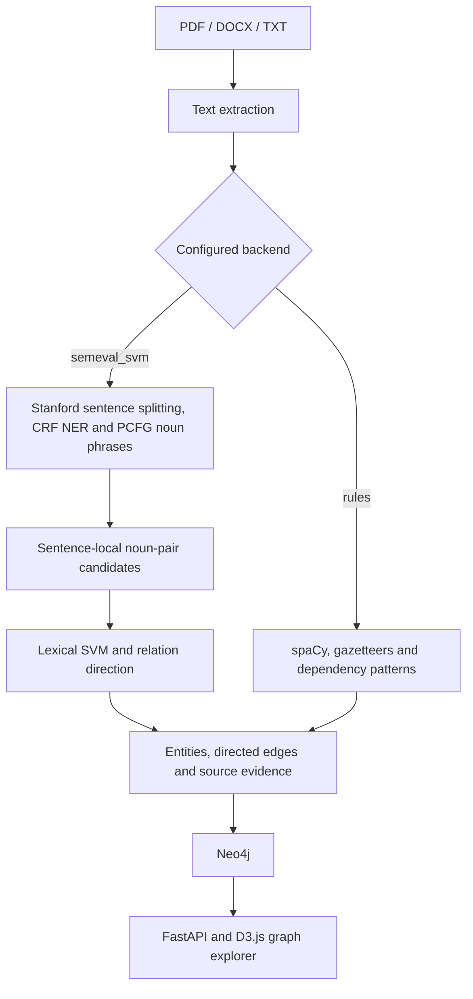

# 🧠 Doc2Graph — Knowledge Graph Builder from Documents
### Document extraction with Stanford NLP and feature-based SVM

[](https://www.python.org/downloads/)
[](https://neo4j.com/)
[]()
[](https://fastapi.tiangolo.com/)

Doc2Graph extracts entities and relationships from PDF, DOCX and text documents,
stores evidence in Neo4j, and provides a FastAPI API and D3.js graph explorer.

The default `semeval_svm` backend combines Stanford CRF named-entity
recognition, classical PCFG noun-phrase parsing and a locally trained linear SVM.
It runs on CPU and supports the full SemEval-2010 Task 8 relation inventory.
The application selects its backend through `RELATION_BACKEND`, whose default
value is `semeval_svm`. Website uploads use this backend unless
`RELATION_BACKEND` explicitly selects another backend. The Java/CoreNLP runtime
and compiled bridge described below must be installed before uploading.

| Backend | Entity and phrase extraction | Relationship extraction |
|---|---|---|
| `semeval_svm` | Stanford CRF NER and PCFG noun phrases | UTD-inspired lexical SVM, nine directed relation families |
| `classical_news` | Stanford classical NLP | Legacy Stanford supervised news relations |
| `rules` | Regex, gazetteers and spaCy | Dependency patterns and predicate whitelist |
| `learned`, `encoder`, `contextual_v2` | Backend-specific experimental stages | Research implementations documented under `docs/` |

The SVM achieved **78.64% official macro F1** and **73.94% accuracy** on 2,717
SemEval test examples with supplied noun pairs. Automatic document extraction
has live text smoke coverage and awaits a reviewed end-to-end benchmark.
The selected model uses lexical features and a direct 19-class classifier.
Full UTD linguistic and knowledge features are future work.

See the [measured results](docs/UTD_SVM_INITIAL_RESULTS.md) and
[pipeline details](docs/SEMEVAL_SVM_PIPELINE.md).

---

## 🗺️ Architecture Overview



---

## 🚀 Quick Start

### 1. Prerequisites & Installation

```bash
# Clone the repository and navigate into it
cd Doc2Graph

# Create and activate virtual environment
python -m venv .venv
# On Windows:
.venv\Scripts\activate
# On Linux/macOS:
# source .venv/bin/activate

# Install dependencies
pip install -r requirements.txt
python -m spacy download en_core_web_sm
```

### 2. Environment Configuration

Copy the example environment configuration:
```bash
copy .env.example .env     # Windows
# cp .env.example .env     # Linux/macOS
```

Ensure your `.env` contains:
```env
NEO4J_USER=neo4j
NEO4J_PASSWORD=changeme
NEO4J_URI=bolt://localhost:7687
PIPELINE_MODE=accurate
RELATION_BACKEND=semeval_svm
UTD_SVM_MODEL_PATH=models/utd_svm
MAX_UPLOAD_MB=50
RESOLUTION_THRESHOLD=0.85
```

### 3. Start Neo4j Database

Start Neo4j using Docker Compose:
```bash
docker compose up neo4j -d
```
Neo4j Browser will be accessible at: `http://localhost:7474` (username: `neo4j`, password: `changeme`).

### 4. Run the API & Web Dashboard

Start the FastAPI backend with the interactive D3.js web interface:
```bash
uvicorn src.api.app:app --reload --port 8000
```

- **Interactive D3.js Web UI**: [http://localhost:8000](http://localhost:8000)
- **Interactive Swagger API Docs**: [http://localhost:8000/docs](http://localhost:8000/docs)

The web view shows only the most recently selected successful upload. Each new
upload clears the previous view and switches to that file when processing
finishes. The filename is shown above the upload area. Graph counts, search,
entity details, and neighborhood focus all use that document's evidence.
Refreshing retains the document selection. Existing documents remain stored;
they are not combined in this view.

---

## 💻 CLI Usage

### Ingest Documents Directly
Ingest all PDF, DOCX, and TXT files in a directory directly into Neo4j:
```bash
python scripts/ingest_sample.py --input data/raw/
```
Or process an individual document:
```bash
python scripts/ingest_sample.py --input data/raw/sample_business_news.txt --mode accurate
```

Each successful ingestion also writes the resolved, pre-Neo4j graph payload to
`data/processed/<sha256>.json`. The JSON contains canonical entities, mention
offsets and source text, relationship evidence, confidence, and stable source
and target IDs. Unsupported predicates are omitted rather than emitted as
generic `RELATED_TO` edges. Set `debug_pipeline: true` in `config/config.yaml` to
enable stage-level pipeline logging.

### Repository artifacts

Source, tests, trained models, sample inputs and benchmark reports are versioned.
Downloaded benchmark corpora, generated source snapshots, temporary evaluation
runs and local planning notes are excluded from Git. Restore Re-DocRED inputs
using the [dataset instructions](data/external/redocred/README.md); SemEval
inputs are provisioned as described in the training section below.

### Stanford + SVM setup and usage

Install the Python dependencies above. For the SVM artifact used here, the
recorded scikit-learn version is 1.6.1. The Stanford backend also requires
OpenJDK 17, CoreNLP 4.5.8 and its matching English model jar. The current client
expects the following local runtime layout.

```text
.runtime/jdk17/bin/java.exe
.runtime/jdk17/bin/javac.exe
.runtime/stanford_classical/stanford-corenlp-4.5.8.jar
.runtime/stanford_classical/stanford-corenlp-4.5.8-models.jar
.runtime/stanford_classical/lib/
models/utd_svm/model.joblib
models/utd_svm/manifest.json
```

Obtain the Java and Stanford distributions from their official publishers and
retain their license notices. The local runtime and trained artifacts may need
to be provisioned separately on a fresh checkout. Stanford publishes its code,
model downloads and licensing details on the [CoreNLP website](https://stanfordnlp.github.io/CoreNLP/).

Compile the bridge from the repository root in PowerShell, then restart any
running application workers so they load the new bridge.

```powershell
& '.runtime/jdk17/bin/javac.exe' -encoding UTF-8 -cp '.runtime/stanford_classical/*;.runtime/stanford_classical/lib/*' -d java/stanford-classical-bridge/build java/stanford-classical-bridge/src/StanfordClassicalBridge.java
```

Inspect a PDF and export its graph without a database connection.

```powershell
python scripts/inspect_document.py example.pdf --relation-backend semeval_svm --output output/svm_graph.json
```

API uploads and CLI ingestion use this backend by default. You can also select
it explicitly through the environment. Restart the API after changing settings.
`UTD_SVM_MODEL_PATH` selects the trusted local model directory.

```powershell
$env:RELATION_BACKEND = 'semeval_svm'
$env:UTD_SVM_MODEL_PATH = 'models/utd_svm'
uvicorn src.api.app:app --reload --port 8000
# Alternatively, ingest directly into the configured Neo4j instance.
# python scripts/ingest_sample.py --input data/raw/example.pdf
```

For pair classification alone, mark the two phrases explicitly.

```powershell
python scripts/predict_utd_svm.py 'The <e1>water</e1> is in the <e2>bottle</e2>.'
```

The nine families are Cause?Effect, Instrument?Agency, Product?Producer,
Content?Container, Entity?Origin, Entity?Destination, Component?Whole,
Member?Collection and Message?Topic. Each has two directions. `Other` suppresses
a semantic edge. Ordinary noun phrases become document-scoped `CONCEPT` nodes.
Predictions carry sentence evidence and unknown assertion status. Confidence is
nullable, and the UI displays ?confidence unavailable? for these predictions.

Automatic candidate selection considers innermost noun phrases, at most 200
characters apart and 100 pairs per sentence. Pipeline results record evaluated
and skipped pair counts. This candidate policy can produce extra relationships.
The Java client also has an outstanding limitation involving blocking reads
without enforced request deadlines. Live database round-trip validation of the
SVM backend is pending.

### SVM training and evaluation

Place the original `TRAIN_FILE.TXT`, `TEST_FILE_FULL.TXT` and official Perl scorer
under `data/external/semeval2010/`. The existing download manifest records the
archive source and hash. The training script chooses settings on a fixed
training-only development split, then refits all 8,000 official training examples.
It covers every relation family. Evaluation uses the 2,717 official test examples.

Use new output directories to preserve existing runs.

```powershell
python scripts/train_utd_svm.py --output models/utd_svm_run2
python scripts/evaluate_utd_svm.py --model models/utd_svm_run2 --output output/utd_svm_run2
perl data/external/semeval2010/semeval2010_task8_scorer-v1.2.pl output/utd_svm_run2/predictions.txt output/utd_svm_run2/gold.txt
```

The official metric is direction-aware macro F1 over the nine relation families.
Development selections and model/data hashes are recorded with the artifacts.
The held-out test results have already been inspected for the current model.
Further test-driven changes must account for that evaluation history.
The [build guide](docs/UTD_SVM_BUILD_GUIDE.md) describes the feature roadmap.

### Rules backend whitelist configuration

Edit `canonical_relations` in `config/relations.yaml` to control which extracted
predicates become graph edges. Each relation defines matching `lemmas`, optional
`requires_prep` values, and allowed `entity_type_pairs`. Set `lemma_swap: true`
when the extracted subject and object must be reversed to express the canonical
edge direction (for example, "Acme hired Alice" becomes `Alice EMPLOYED_BY Acme`).
The ingestion pipeline enables all configured relations, including the extended
`LEADS`, `PROVIDED`, `FUNDED`, `DEVELOPED`, `USES`, and `STORES_DATA_IN` types.
Predicates that do not match the configured lemma, preposition, and type pair are
excluded from the ingested graph.

### Benchmark & Model Training
Evaluate NER quality and train the Logistic Regression scorers on annotated gold sets using 5-fold cross-validation:
```bash
# Run evaluation
python scripts/benchmark.py --eval data/eval/

# Run evaluation and train models
python scripts/benchmark.py --eval data/eval/ --train
```

---

## 🧪 Testing

Run the unified test suite (both frontend D3.js and backend pytest tests):
```bash
npm test
# or: make test
```

Or run backend tests directly via pytest:
```bash
pytest
```

For the real Neo4j document-isolation check, run with `DOC2GRAPH_NEO4J_TESTS=1` in the environment. It creates fixture nodes in a transaction and always rolls them back. Frontend state tests can also be run directly with `node --test tests/test_document_view.cjs`.

Recent model improvements include stable, versioned one-hot features for the
retrained relation scorer, multiple gazetteer matches per sentence, organization
name tokenization, passive and prepositional relations, position-aware
coreference, and correct evidence IDs across sentence windows. Negated
statements are excluded from asserted graph facts. Cross-document merges retain
aliases and source mentions.

Latest pipeline integration verification completed with **281 Python tests
passed and one skipped**, plus a JavaScript syntax check. The run emitted a
pytest-cache permission warning. Tests cover software behavior and graph-write
payloads. The SVM has a live Stanford-to-classifier text smoke test and mocked
database-write coverage. Its supplied-pair benchmark and automatic extraction
validation are documented in the linked results and pipeline notes above.

Older small-fixture scorer results are retained in the
[model artifact notes](models/README.md).

Uploads reject binary or damaged text before NLP. PDF/DOCX extraction failures
are reported as errors, never decoded as raw text. The upload tests cover real
PDF bytes, malformed documents, Unicode text, and job status responses.

If an older version imported raw PDF bytes, re-uploading alone does not remove
the stored corruption. `scripts/repair_corrupt_imports.py <original PDFs>` offers
a read-only repair preview; `--apply` exports a snapshot to `data/backups/`,
preserves the old graph under `ArchivedEntity`, `ArchivedChunk`, and
`ArchivedDocument` labels with an `archive_batch`, and rebuilds the active graph.
It requires all active documents to match the supplied originals by SHA-256 and
their first stored chunks to contain raw PDF headers; it refuses mixed datasets.
Archived data is retained in Neo4j and excluded from the active entity graph.

Test coverage includes:
- `test_utd_svm.py`: Marker parsing, Unicode spans and relation direction scoring.
- `test_semeval_pipeline.py`: Noun-pair extraction, nullable confidence and graph-write payloads.
- `test_ner.py`: Regex pattern matching, gazetteer extraction, spaCy statistical NER layer.
- `test_span_merger.py`: Priority span conflict resolution.
- `test_coref_resolver.py`: Pronoun recency, definite noun phrase resolution, alias detection.
- `test_relation_extractor.py`: SVO, appositive, prepositional, nominal dependency patterns + pronoun substitution.
- `test_predicate_normalizer.py`: Relation mapping, whitelist filtering, subject-object swap flags.
- `test_entity_resolver.py`: Initials-key generation, token overlap, abbreviation blocking, Jaro-Winkler scoring.
- `test_graph_builder.py`: Cypher payload transformations, label mappings, edge consolidation.
- `test_integration.py`: Sequential end-to-end NLP pipeline execution.

---

## 📁 Repository Structure

```
Doc2Graph/
├── config/
│   ├── config.yaml                # Non-secret pipeline & model configuration
│   └── relations.yaml             # Canonical relation whitelist
├── data/
│   ├── eval/                      # Evaluation gold sets (NER, relations, resolution)
│   ├── gazetteers/                # Domain dictionary wordlists
│   └── raw/                       # Sample raw input documents
├── models/                        # Versioned trained models, including utd_svm/
├── notebooks/
│   └── exploration.ipynb          # Interactive pipeline exploration
├── scripts/
│   ├── benchmark.py               # Evaluation & training harness
│   ├── ingest_sample.py           # CLI document ingestion
│   └── setup_neo4j.cypher         # Neo4j schema, constraints & full-text indexes
├── src/
│   ├── api/
│   │   ├── app.py                 # FastAPI application & lifespan
│   │   ├── routes/                # Ingest, graph exploration, and search routes
│   │   ├── static/                # D3.js interactive force-directed web dashboard
│   │   ├── job_store.py           # Async SQLite job store
│   │   └── workers.py             # BackgroundTask dispatch
│   ├── graph/
│   │   ├── entity_resolver.py     # Candidate blocking, similarity & LR resolution
│   │   ├── graph_builder.py       # Neo4j MERGE & Chunk provenance construction
│   │   └── neo4j_client.py        # Async Neo4j driver
│   ├── ingestion/
│   │   ├── loader.py              # PDF, DOCX, TXT loaders
│   │   ├── pdf_cleaner.py         # Header/footer, de-hyphenation, table strip
│   │   └── preprocessor.py        # Sentence splitting, NFKC normalizer, hashing
│   ├── nlp/
│   │   ├── ner.py                 # 3-layer NER runner
│   │   ├── coref_resolver.py      # Rule-based coreference resolver
│   │   ├── relation_extractor.py  # Dependency pattern extractor
│   │   ├── predicate_normalizer.py# Canonical whitelist normalizer
│   │   └── relation_scorer.py     # Relation confidence scorer
│   └── pipeline.py                # Sequential pipeline orchestrator with file lock
└── tests/                         # Python and frontend regression tests
```
