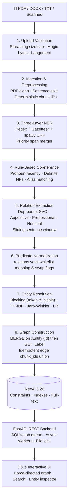

# 🧠 Doc2Graph — Knowledge Graph Builder from Documents
### Classical ML Edition (v6)

[](https://www.python.org/downloads/)
[](https://neo4j.com/)
[]()
[](https://fastapi.tiangolo.com/)

> **Classical NLP & ML Architecture:**
> - **Zero LLM API calls** · **No GPU required** · Runs entirely on CPU
> - Pre-trained spaCy (`en_core_web_sm`) + Regex + Gazetteers
> - Rule-based coreference resolution
> - Dependency-parse syntactic pattern relation extraction
> - Inverted-index candidate blocking + TF-IDF / Jaro-Winkler entity resolution
> - Neo4j native graph storage + D3.js v7 interactive visualization

---

## 🗺️ Architecture Overview



---

## 🚀 Quick Start

### 1. Prerequisites & Installation

```bash
# Clone the repository and navigate into it
cd Doc2Graph

# Create and activate virtual environment
python -m venv .venv
# On Windows:
.venv\Scripts\activate
# On Linux/macOS:
# source .venv/bin/activate

# Install dependencies
pip install -r requirements.txt
python -m spacy download en_core_web_sm
```

### 2. Environment Configuration

Copy the example environment configuration:
```bash
copy .env.example .env     # Windows
# cp .env.example .env     # Linux/macOS
```

Ensure your `.env` contains:
```env
NEO4J_USER=neo4j
NEO4J_PASSWORD=changeme
NEO4J_URI=bolt://localhost:7687
PIPELINE_MODE=accurate
MAX_UPLOAD_MB=50
RESOLUTION_THRESHOLD=0.85
```

### 3. Start Neo4j Database

Start Neo4j using Docker Compose:
```bash
docker compose up neo4j -d
```
Neo4j Browser will be accessible at: `http://localhost:7474` (username: `neo4j`, password: `changeme`).

### 4. Run the API & Web Dashboard

Start the FastAPI backend with the interactive D3.js web interface:
```bash
uvicorn src.api.app:app --reload --port 8000
```

- **Interactive D3.js Web UI**: [http://localhost:8000](http://localhost:8000)
- **Interactive Swagger API Docs**: [http://localhost:8000/docs](http://localhost:8000/docs)

The web view shows only the most recently selected successful upload. Each new
upload clears the previous view and switches to that file when processing
finishes. The filename is shown above the upload area. Graph counts, search,
entity details, and neighborhood focus all use that document's evidence.
Refreshing retains the document selection. Existing documents remain stored;
they are not combined in this view.

---

## 💻 CLI Usage

### Ingest Documents Directly
Ingest all PDF, DOCX, and TXT files in a directory directly into Neo4j:
```bash
python scripts/ingest_sample.py --input data/raw/
```
Or process an individual document:
```bash
python scripts/ingest_sample.py --input data/raw/sample_business_news.txt --mode accurate
```

### Benchmark & Model Training
Evaluate NER quality and train the Logistic Regression scorers on annotated gold sets using 5-fold cross-validation:
```bash
# Run evaluation
python scripts/benchmark.py --eval data/eval/

# Run evaluation and train models
python scripts/benchmark.py --eval data/eval/ --train
```

---

## 🧪 Testing

Run the pytest suite (73 default tests and one optional Neo4j integration test):
```bash
python -m pytest tests/
```

For the real Neo4j document-isolation check, run with
`DOC2GRAPH_NEO4J_TESTS=1` in the environment. It creates fixture nodes in a
transaction and always rolls them back. Run the three frontend state tests with
`node --test tests/test_document_view.cjs`.

Recent model improvements include stable, versioned one-hot features for the
retrained relation scorer, multiple gazetteer matches per sentence, organization
name tokenization, passive and prepositional relations, position-aware
coreference, and correct evidence IDs across sentence windows. Negated
statements are excluded from asserted graph facts. Cross-document merges retain
aliases and source mentions.

Local validation: 74 Python tests (including the Neo4j check) and three frontend
tests pass; NER F1 improved from 0.945 to 1.000 on the existing
10-example dataset; all 15 full-text relation regression examples match exactly.
The relation scorer's five-fold cross-validation F1 is 0.88 on 20 labeled feature
rows. These are small development datasets, not a general-domain accuracy claim.
See [model artifact notes](models/README.md) for the schema and retraining command.

Uploads reject binary or damaged text before NLP. PDF/DOCX extraction failures
are reported as errors, never decoded as raw text. The upload tests cover real
PDF bytes, malformed documents, Unicode text, and job status responses.

If an older version imported raw PDF bytes, re-uploading alone does not remove
the stored corruption. `scripts/repair_corrupt_imports.py <original PDFs>` offers
a read-only repair preview; `--apply` exports a snapshot to `data/backups/`,
preserves the old graph under `ArchivedEntity`, `ArchivedChunk`, and
`ArchivedDocument` labels with an `archive_batch`, and rebuilds the active graph.
It requires all active documents to match the supplied originals by SHA-256 and
their first stored chunks to contain raw PDF headers; it refuses mixed datasets.
Archived data is retained in Neo4j and excluded from the active entity graph.

Test coverage includes:
- `test_ner.py`: Regex pattern matching, gazetteer extraction, spaCy CRF layer.
- `test_span_merger.py`: Priority span conflict resolution.
- `test_coref_resolver.py`: Pronoun recency, definite noun phrase resolution, alias detection.
- `test_relation_extractor.py`: SVO, appositive, prepositional, nominal dependency patterns + pronoun substitution.
- `test_predicate_normalizer.py`: Relation mapping, whitelist filtering, subject-object swap flags.
- `test_entity_resolver.py`: Initials-key generation, token overlap, abbreviation blocking, Jaro-Winkler scoring.
- `test_graph_builder.py`: Cypher payload transformations, label mappings, edge consolidation.
- `test_integration.py`: Sequential end-to-end NLP pipeline execution.

---

## 📁 Repository Structure

```
Doc2Graph/
├── config.yaml                    # Non-secret pipeline configuration
├── config/
│   └── relations.yaml             # Canonical relation whitelist
├── data/
│   ├── eval/                      # Evaluation gold sets (NER, relations, resolution)
│   ├── gazetteers/                # Domain dictionary wordlists
│   └── raw/                       # Sample raw input documents
├── models/                        # Serialized Logistic Regression models
├── notebooks/
│   └── exploration.ipynb          # Interactive pipeline exploration
├── scripts/
│   ├── benchmark.py               # Evaluation & training harness
│   ├── ingest_sample.py           # CLI document ingestion
│   └── setup_neo4j.cypher         # Neo4j schema, constraints & full-text indexes
├── src/
│   ├── api/
│   │   ├── app.py                 # FastAPI application & lifespan
│   │   ├── routes/                # Ingest, graph exploration, and search routes
│   │   ├── static/                # D3.js interactive force-directed web dashboard
│   │   ├── job_store.py           # Async SQLite job store
│   │   └── workers.py             # BackgroundTask dispatch
│   ├── graph/
│   │   ├── entity_resolver.py     # Candidate blocking, similarity & LR resolution
│   │   ├── graph_builder.py       # Neo4j MERGE & Chunk provenance construction
│   │   └── neo4j_client.py        # Async Neo4j driver
│   ├── ingestion/
│   │   ├── loader.py              # PDF, DOCX, TXT loaders
│   │   ├── pdf_cleaner.py         # Header/footer, de-hyphenation, table strip
│   │   └── preprocessor.py        # Sentence splitting, NFKC normalizer, hashing
│   ├── nlp/
│   │   ├── ner.py                 # 3-layer NER runner
│   │   ├── coref_resolver.py      # Rule-based coreference resolver
│   │   ├── relation_extractor.py  # Dependency pattern extractor
│   │   ├── predicate_normalizer.py# Canonical whitelist normalizer
│   │   └── relation_scorer.py     # Relation confidence scorer
│   └── pipeline.py                # Sequential pipeline orchestrator with file lock
└── tests/                         # Python and frontend regression tests
```

