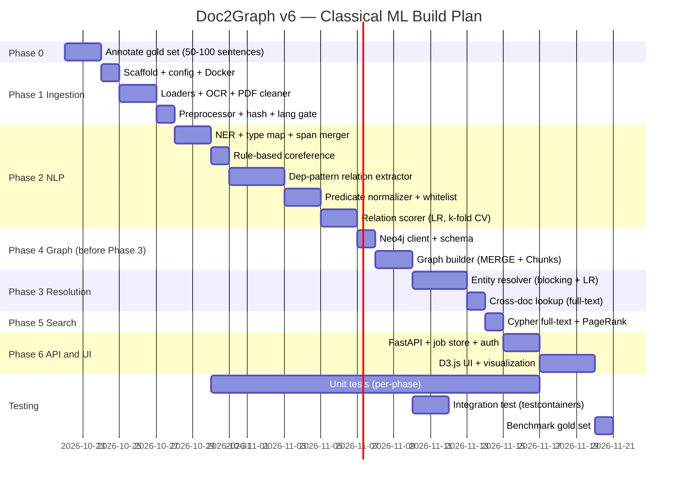

# 🧠 Doc2Graph — Knowledge Graph Builder from Documents
## Implementation Plan v6 — Classical ML Edition

> [!IMPORTANT]
> **Constraints (Final)**: No LLM API calls · No deep-learning models · Classical NLP + ML only · CPU-only · Neo4j backend · Interpretable & Modular
>
> *spaCy `en_core_web_sm` uses a Tok2Vec + CRF architecture — no GPU transformer layers, runs entirely on CPU. This is the standard classical NLP baseline.*

---

## ✅ Final Decisions

| Question | Decision |
|---|---|
| Domain | General (news / business / Wikipedia-style text) |
| Language | English only — `langdetect` rejects non-English at upload time (HTTP 422) |
| NER model | `spaCy en_core_web_sm` (CRF-based) + gazetteer + regex |
| Coreference | Rule-based only (pronoun, definite NP, alias) |
| Relation extraction | Dependency-parse patterns only (SVO, appositive, prepositional, nominal) |
| Entity resolution | TF-IDF + Jaro-Winkler + token-overlap + initials-key; LR scorer |
| Search | Full-text index only (no vector index — no embeddings) |
| Neo4j | Docker Compose, pinned `neo4j:5.26-community` |
| Job queue | `BackgroundTasks` + cross-process file lock |
| CLI mode | Yes — `scripts/ingest_sample.py` |

---

## 🗺️ Architecture Overview

```mermaid
flowchart TD
    A["📄 PDF / TXT / DOCX / Scanned"] --> V["Upload validation\nstreaming size cap · magic bytes\nlangdetect at upload time"]
    V --> B["Ingestion\nOCR · PDF clean · spaCy sentence split\nSHA-256 hash · deterministic chunk IDs"]
    B --> C["① NER\nspaCy en_core_web_sm CRF\n+ gazetteer (rapidfuzz) + regex\nSpan merge · unified type map"]
    C --> D["② Coreference (rule-based)\nPronoun → nearest named entity\nDefinite NP → nearest ORG/PERSON\nAlias matching (string inclusion + Jaro-Winkler)"]
    D --> E["③ Relation Extraction\nDep-parse patterns: SVO · appos · prep · nominal\nsentence-window (stride 2)"]
    E --> F["④ Predicate Normalization\nverb lemma + prep context → canonical type\nRelation whitelist (YAML) with swap flags"]
    F --> G["⑤ Entity Resolution\nBlocking: token-overlap + initials-key\nTF-IDF cosine + Jaro-Winkler + initials match\nLR scorer (k-fold CV) · cross-doc full-text lookup"]
    G --> H["⑥ Graph Builder\nMERGE entity then SET :Label\nMERGE rel, union chunk_ids\nChunk provenance nodes"]
    H --> I[("Neo4j 5.26\nConstraints + full-text index + GDS\nNative rel types")]
    I --> J["Query Engine\nCypher · full-text search · shortestPath · PageRank"]
    J --> K["FastAPI\nFile-lock guard · BackgroundTasks\nSQLite job store · API-key auth"]
    K --> L["D3.js UI\nForce-directed graph · search · stats"]
```



> [!NOTE]
> **Pipeline is strictly sequential:** NER → Coreference → Relation Extraction. Coreference resolves "He joined Google" before the relation extractor sees it. No parallelism between these stages.

---

## 📁 Project Structure

```
Doc2Graph/
├── README.md
├── requirements.txt
├── requirements-fast.txt          # alias — same deps, no GPU extras
├── Dockerfile
├── .dockerignore
├── docker-compose.yml
├── .env.example
├── config.yaml                    # non-secret: thresholds, batch sizes, mode
│
├── config/
│   └── relations.yaml             # canonical relation whitelist
│
├── data/
│   ├── raw/                       # input documents
│   ├── processed/                 # intermediate JSON (hash-keyed)
│   ├── eval/
│   │   ├── ner_gold.jsonl         # 50–100 annotated sentences
│   │   ├── relations_gold.jsonl
│   │   └── resolution_gold.jsonl
│   ├── gazetteers/
│   │   ├── persons.txt            # start empty; populate per domain
│   │   ├── organizations.txt
│   │   └── locations.txt
│   └── jobs.sqlite                # job status store
│
├── src/
│   ├── __init__.py
│   ├── pipeline.py                # orchestrator: sequential stages, file lock
│   ├── config.py                  # pydantic-settings v2, yaml merge
│   ├── pipeline_lock.py           # cross-process file lock
│   ├── type_map.py                # spaCy → unified internal type mapping
│   │
│   ├── ingestion/
│   │   ├── __init__.py
│   │   ├── loader.py              # PDF / DOCX / TXT loaders
│   │   ├── ocr.py                 # pytesseract fallback for scanned PDFs
│   │   ├── pdf_cleaner.py         # header/footer, de-hyphenation, table strip
│   │   └── preprocessor.py       # spaCy sentence split, normalize, SHA-256, langdetect
│   │
│   ├── nlp/
│   │   ├── __init__.py
│   │   ├── ner.py                 # spaCy CRF NER + gazetteer + regex
│   │   ├── span_merger.py         # span merge policy (regex > gazetteer > model)
│   │   ├── coref_resolver.py      # rule-based coreference
│   │   ├── relation_extractor.py  # dep-parse patterns (SVO, appos, prep, nominal)
│   │   ├── relation_scorer.py     # LR confidence scorer (k-fold CV)
│   │   └── predicate_normalizer.py# verb lemma → canonical type + swap flags
│   │
│   ├── graph/
│   │   ├── __init__.py
│   │   ├── entity_resolver.py     # TF-IDF + Jaro-Winkler + initials, cross-doc lookup
│   │   ├── graph_builder.py       # MERGE+SET labels, MERGE+union edges
│   │   └── neo4j_client.py        # async driver, batched writes, schema init
│   │
│   ├── search/
│   │   ├── __init__.py
│   │   ├── query_engine.py        # full-text + Cypher builder
│   │   └── ranking.py             # GDS PageRank / Degree centrality
│   │
│   └── api/
│       ├── __init__.py
│       ├── app.py                 # FastAPI + lifespan (schema init) + CORS
│       ├── auth.py                # API-key dependency
│       ├── routes/
│       │   ├── ingest.py          # POST /upload, GET /jobs/{id}
│       │   ├── graph.py           # GET /entities, /relations, /path
│       │   └── search.py          # GET /search
│       ├── schemas.py             # Pydantic v2 models
│       ├── workers.py             # BackgroundTasks dispatch
│       ├── job_store.py           # SQLite-backed job store
│       └── static/
│           ├── index.html
│           ├── style.css
│           └── graph.js           # D3.js force-directed visualization
│
├── tests/
│   ├── conftest.py                # testcontainers Neo4j fixture
│   ├── test_ner.py
│   ├── test_span_merger.py
│   ├── test_coref_resolver.py
│   ├── test_relation_extractor.py
│   ├── test_predicate_normalizer.py
│   ├── test_entity_resolver.py
│   ├── test_graph_builder.py
│   └── test_integration.py        # end-to-end against testcontainers Neo4j
│
├── scripts/
│   ├── setup_neo4j.cypher         # constraints + full-text index + GDS
│   ├── ingest_sample.py           # CLI: --input, --mode
│   └── benchmark.py               # NLP quality against gold set
│
└── notebooks/
    └── exploration.ipynb
```

---

## 🔬 Component Details

---

### Phase 0 — Evaluation First

> [!IMPORTANT]
> Annotate **50–100 sentences** from real general-domain text into `data/eval/` before writing NLP code. All model and rule choices are measured, not guessed.

| Gold set | Covers | Metrics |
|---|---|---|
| `ner_gold.jsonl` | NER spans | Span-level F1 (exact match) |
| `relations_gold.jsonl` | (subj, pred, obj) triples | Micro-F1 |
| `resolution_gold.jsonl` | Entity merge/no-merge pairs | Precision / Recall |

- Use **CoNLL-2003** and **DocRED** as public reference baselines.
- Scorer and resolver: **k-fold CV (k=5)** on gold set — no train/eval leakage.

---

### Phase 1 — Document Ingestion

#### Upload validation (streaming, magic bytes, language gate)

```python
# routes/ingest.py
CHUNK_SIZE = 8192

async def read_and_validate(file: UploadFile, settings: Settings) -> tuple[bytes, str]:
    max_bytes = settings.max_upload_mb * 1024 * 1024
    if file.size and file.size > max_bytes:
        raise HTTPException(413, "File exceeds size limit")

    chunks, total = [], 0
    while True:
        chunk = await file.read(CHUNK_SIZE)
        if not chunk:
            break
        total += len(chunk)
        if total > max_bytes:
            raise HTTPException(413, "File exceeds size limit during upload")
        chunks.append(chunk)
    content = b"".join(chunks)

    # Magic-byte detection
    if content.startswith(b"%PDF"):
        ftype = "pdf"
    elif content.startswith(b"PK\x03\x04"):
        import zipfile, io
        try:
            with zipfile.ZipFile(io.BytesIO(content)) as zf:
                if "[Content_Types].xml" in zf.namelist():
                    ftype = "docx"
                else:
                    raise HTTPException(415, "ZIP is not a DOCX")
        except zipfile.BadZipFile:
            raise HTTPException(415, "Corrupt file")
    elif content[:512].isascii() or content[:3] == b"\xef\xbb\xbf":
        ftype = "txt"                  # no magic bytes for plaintext
    else:
        raise HTTPException(415, "Unsupported file type")

    return content, ftype
```

#### Language gate — runs at upload time (not in background task)

```python
from langdetect import detect, DetectorFactory
DetectorFactory.seed = 0              # deterministic

def assert_english(text_sample: str):
    lang = detect(text_sample[:2000])
    if lang != "en":
        raise HTTPException(422, f"Language '{lang}' not supported. English only.")
```

#### Sentence splitting — unified on spaCy

```python
# preprocessor.py — same model used for NER + dep-parse
nlp = spacy.load("en_core_web_sm")
doc = nlp(text)
sentences = [(s.text, s.start_char, s.end_char) for s in doc.sents]
```

**Chunk IDs — deterministic:** `"<doc_sha256>:<sent_idx>"`. Idempotent on re-upload.

**Sentence windows — stride 2:**
```
W0 = [S0, S1, S2]  → triples attributed to S1 (center)
W1 = [S2, S3, S4]  → triples attributed to S3
```

| Sub-task | Technique | Library |
|---|---|---|
| PDF loading | Layout-aware | `pdfplumber`, `PyMuPDF` |
| OCR fallback | Scanned page detection | `pytesseract` |
| PDF cleaning | Header/footer, de-hyphenation, table strip | Custom heuristics |
| DOCX loading | Paragraph extraction | `python-docx` |
| Sentence splitting | spaCy sentencizer (unified) | `spacy` |
| Normalization | Regex, unicode | `re`, `unicodedata` |
| Language gate | Reject non-English | `langdetect` |
| Content hash | SHA-256 → idempotent MERGE | `hashlib` |

---

### Phase 2a — Named Entity Recognition

**Three-layer NER with span merge policy.**

#### Layers (priority order)

| Priority | Layer | Library | Notes |
|---|---|---|---|
| 1 (highest) | Regex patterns | `re` | Dates, emails, IDs, codes, monetary values |
| 2 | Gazetteer matching | `rapidfuzz` | Exact + fuzzy; starts empty; populate per domain |
| 3 (fallback) | spaCy CRF NER | `spacy en_core_web_sm` | Tok2Vec + NER head, CPU only |

Internal types: `PERSON, ORG, GPE, PRODUCT, EVENT, LAW`
`DATE` and `MONEY` stored as edge/node properties, not graph nodes.

#### Type mapping (`type_map.py`)

```python
SPACY_TO_INTERNAL = {
    "PERSON":  "PERSON",
    "ORG":     "ORG",
    "GPE":     "GPE",
    "LOC":     "GPE",   # natural features → GPE
    "FAC":     "GPE",   # buildings/airports → GPE
    "PRODUCT": "PRODUCT",
    "EVENT":   "EVENT",
    "LAW":     "LAW",
    "DATE":    "DATE",  # property only
    "MONEY":   "MONEY", # property only
}
NODE_TYPES = {"PERSON", "ORG", "GPE", "PRODUCT", "EVENT", "LAW"}
```

#### Span merge policy (`span_merger.py`)

```python
def merge_spans(spans_by_source: dict[str, list[Span]]) -> list[Span]:
    """Priority: regex(0) > gazetteer(1) > spaCy model(2). Longest span wins ties."""
    candidates = []                           # build list here — not outside loop
    for priority, spans in enumerate(spans_by_source.values()):
        for s in spans:
            candidates.append(ScoredSpan(
                start=s.start, end=s.end,
                label=s.label, priority=priority,
                length=s.end - s.start
            ))
    candidates.sort(key=lambda s: (s.priority, -s.length))
    return greedy_non_overlapping(candidates)
```

---

### Phase 2b — Coreference Resolution (Rule-Based)

No DL model. Three rule tiers applied in order:

```python
# coref_resolver.py
class RuleBasedCorefResolver:
    PRONOUNS_PERSON = {"he", "him", "his", "she", "her", "hers", "they", "them", "their"}
    PRONOUNS_ORG    = {"it", "its"}
    DEF_NP_ORG      = {"the company", "the firm", "the organization", "the group",
                        "the bank", "the agency", "the institution"}
    DEF_NP_PERSON   = {"the man", "the woman", "the person", "the official",
                        "the executive", "the director", "the ceo", "the president"}

    def resolve(self, sentences: list[Sentence], entities: list[Entity]) -> ClusterMap:
        clusters: dict[str, list[Span]] = {}
        recent_person: Entity | None = None
        recent_org:    Entity | None = None

        for sent in sentences:
            for ent in sent.entities:
                if ent.type == "PERSON": recent_person = ent
                if ent.type == "ORG":    recent_org    = ent

            for token in sent.tokens:
                low = token.text.lower()
                if low in self.PRONOUNS_PERSON and recent_person:
                    self._add_to_cluster(clusters, recent_person.id, token.span)
                elif low in self.PRONOUNS_ORG and recent_org:
                    self._add_to_cluster(clusters, recent_org.id, token.span)
                elif low in self.DEF_NP_ORG and recent_org:
                    self._add_to_cluster(clusters, recent_org.id, token.span)
                elif low in self.DEF_NP_PERSON and recent_person:
                    self._add_to_cluster(clusters, recent_person.id, token.span)

            # Tier 3: Alias (string inclusion + Jaro-Winkler)
            for ent in sent.entities:
                for known in entities:
                    if ent.id != known.id and self._is_alias(ent.text, known.text):
                        self._add_to_cluster(clusters, known.id, ent.span)
        return clusters

    def _is_alias(self, short: str, full: str) -> bool:
        if short.lower() in full.lower().split():
            return True
        from rapidfuzz.distance import JaroWinkler
        return JaroWinkler.similarity(short, full) >= 0.85
```

> [!NOTE]
> Rule-based coref recall is lower on pronoun-heavy text than DL models. This is expected and documented. The pipeline still works — it simply produces fewer edges from pronoun-heavy sentences.

---

### Phase 2c — Relation Extraction (Dependency Patterns)

```python
# relation_extractor.py
class DepPatternExtractor:
    def extract(self, doc, entities) -> list[RawTriple]:
        triples = []
        span_map = build_span_map(entities)
        for sent in doc.sents:
            triples += self._svo(sent, span_map)
            triples += self._appositive(sent, span_map)
            triples += self._prepositional(sent, span_map)
            triples += self._nominal(sent, span_map)
        return triples

    def _svo(self, sent, span_map):
        """'Musk founded Tesla' → (Musk, found, Tesla)"""
        triples = []
        for token in sent:
            if token.pos_ == "VERB":
                subj = self._find_dep(token, {"nsubj", "nsubjpass"})
                obj  = self._find_dep(token, {"dobj", "attr", "oprd"})
                if subj and obj:
                    se = span_map.get(subj); oe = span_map.get(obj)
                    if se and oe:
                        prep = next((c.text for c in token.children if c.dep_=="prep"), None)
                        triples.append(RawTriple(
                            subject=se, predicate=token.lemma_,
                            object=oe, prep=prep, source="svo",
                            sent_idx=sent.start))
        return triples

    def _appositive(self, sent, span_map):
        """'Elon Musk, CEO of Tesla' → (Elon Musk, appos, Tesla)"""
        triples = []
        for token in sent:
            if token.dep_ == "appos":
                he = span_map.get(token.head); ae = span_map.get(token)
                if he and ae:
                    triples.append(RawTriple(
                        subject=he, predicate="appos", object=ae,
                        source="appos", sent_idx=sent.start))
        return triples

    def _prepositional(self, sent, span_map):
        """'director of Tesla', 'based in California'"""
        triples = []
        for token in sent:
            if token.dep_ == "prep":
                for pobj in token.children:
                    if pobj.dep_ == "pobj":
                        he = span_map.get(token.head); oe = span_map.get(pobj)
                        if he and oe:
                            triples.append(RawTriple(
                                subject=he,
                                predicate=f"{token.head.lemma_}_{token.lemma_}",
                                object=oe, prep=token.text,
                                source="prep", sent_idx=sent.start))
        return triples

    def _nominal(self, sent, span_map):
        """'Tesla founder Musk'"""
        ROLE_NOUNS = {"founder","ceo","director","chairman","president",
                      "head","chief","owner","partner","investor"}
        triples = []
        for token in sent:
            if token.lemma_.lower() in ROLE_NOUNS:
                oe = span_map.get(token.head)
                se = span_map.get(
                    next((c for c in token.children if c.dep_ in {"nmod","poss"}), None))
                if se and oe:
                    triples.append(RawTriple(
                        subject=se, predicate=token.lemma_,
                        object=oe, source="nominal", sent_idx=sent.start))
        return triples

    def _find_dep(self, token, dep_set):
        return next((c for c in token.children if c.dep_ in dep_set), None)
```

#### Confidence Scorer (Logistic Regression)

Features (all interpretable, no embeddings):
- `dep_distance` — token distance between subject and object
- `is_svo`, `is_appos`, `is_prep`, `is_nominal` — one-hot pattern type
- `entity_type_pair` — label-encoded (e.g., PERSON_ORG)
- `verb_in_whitelist` — 1 if predicate lemma matches a canonical entry
- `sentence_length` — proxy for noise
- `has_negation` — 1 if negation token in governor chain

Trained on `relations_gold.jsonl` with k-fold CV (k=5).

---

### Phase 2d — Predicate Normalization (Single Path)

```python
def normalize(triple: RawTriple, relations_config: dict) -> NormalizedTriple:
    for rel_name, conf in relations_config.items():
        for entry in conf["lemmas"]:
            if triple.predicate != entry["lemma"]:
                continue
            if entry.get("requires_prep") and triple.prep not in entry["requires_prep"]:
                continue
            if not type_pair_matches(triple, conf.get("entity_type_pairs", [])):
                continue
            result = swap_subject_object(triple) if entry.get("lemma_swap") else triple
            return NormalizedTriple(rel_name, result.subject, result.object)
    return NormalizedTriple("RELATED_TO", triple.subject, triple.object)
```

#### Canonical Relation Whitelist (`config/relations.yaml`)

```yaml
canonical_relations:

  MEMBER_OF:
    lemmas:
      - {lemma: "join",   requires_prep: null,           lemma_swap: false}
      - {lemma: "work",   requires_prep: ["for", "at"],  lemma_swap: false}
      - {lemma: "belong", requires_prep: ["to"],          lemma_swap: false}
    entity_type_pairs: [[PERSON, ORG]]

  EMPLOYED_BY:
    lemmas:
      - {lemma: "hire",    requires_prep: null, lemma_swap: true}
      - {lemma: "employ",  requires_prep: null, lemma_swap: true}
      - {lemma: "appoint", requires_prep: null, lemma_swap: true}
    entity_type_pairs: [[PERSON, ORG]]

  ACQUIRED:
    lemmas:
      - {lemma: "acquire",  requires_prep: null, lemma_swap: false}
      - {lemma: "buy",      requires_prep: null, lemma_swap: false}
      - {lemma: "purchase", requires_prep: null, lemma_swap: false}
    entity_type_pairs: [[ORG, ORG]]

  LOCATED_IN:
    lemmas:
      - {lemma: "locate",      requires_prep: ["in","at"], lemma_swap: false}
      - {lemma: "base",        requires_prep: ["in","at"], lemma_swap: false}
      - {lemma: "headquarter", requires_prep: ["in","at"], lemma_swap: false}
    entity_type_pairs: [[ORG, GPE], [PERSON, GPE]]

  FOUNDED:
    lemmas:
      - lemma: "found"
        requires_prep: null
        lemma_swap: false
        # Disambiguate "found" (find past) vs "found" (establish):
        # check that the direct object is an ORG entity in predicate_normalizer.py
    entity_type_pairs: [[PERSON, ORG]]

  INVESTED_IN:
    lemmas:
      - {lemma: "invest",  requires_prep: ["in"], lemma_swap: false}
      - {lemma: "fund",    requires_prep: null,   lemma_swap: false}
      - {lemma: "finance", requires_prep: null,   lemma_swap: false}
    entity_type_pairs: [[ORG, ORG], [PERSON, ORG]]

  PARTNER_WITH:
    lemmas:
      - {lemma: "partner",     requires_prep: ["with"], lemma_swap: false}
      - {lemma: "collaborate", requires_prep: ["with"], lemma_swap: false}
    entity_type_pairs: [[ORG, ORG]]
```

---

### Phase 3 — Entity Resolution

#### Blocking (scikit-learn + inverted index, no FAISS)

```python
def build_candidate_pairs(entities: list[Entity]) -> list[tuple[Entity, Entity]]:
    CORP_STOP = {"inc","corp","ltd","llc","co","company","group",
                 "university","foundation","institute","association"}
    pairs = set()

    # Token-overlap blocking
    tok_idx: dict[str, list[Entity]] = defaultdict(list)
    for e in entities:
        toks = {t.lower() for t in e.canonical_name.split() if t.lower() not in CORP_STOP}
        for t in toks:
            tok_idx[t].append(e)
    for bucket in tok_idx.values():
        if len(bucket) <= 100:
            pairs.update(combinations(bucket, 2))

    # Initials-key blocking  ("IBM" ↔ "International Business Machines")
    init_idx: dict[str, list[Entity]] = defaultdict(list)
    for e in entities:
        k = compute_initials_key(e.canonical_name)
        if len(k) >= 2:
            init_idx[k].append(e)
    for bucket in init_idx.values():
        if len(bucket) <= 100:
            pairs.update(combinations(bucket, 2))

    # Type guard: only same-type pairs
    return [(a, b) for a, b in pairs if a.type == b.type and a.id != b.id]
```

#### Scoring (LR, all features classical)

```python
def feature_vector(a: Entity, b: Entity) -> list[float]:
    return [
        JaroWinkler.similarity(a.canonical_name, b.canonical_name),
        tfidf_cosine(a.canonical_name, b.canonical_name),      # char n-gram TF-IDF
        token_overlap_ratio(a.canonical_name, b.canonical_name),
        int(initials_match(a.canonical_name, b.canonical_name)),
        abbreviation_score(a.canonical_name, b.canonical_name),
    ]
# lr.predict_proba([features])[0][1] >= settings.resolution_threshold → merge
```

#### Cross-Document Resolution (full-text + initials_key)

```python
async def resolve_against_graph(entity: Entity, session) -> str | None:
    escaped = lucene_escape(entity.canonical_name)
    ft_rows = await session.run("""
        CALL db.index.fulltext.queryNodes('entity_fulltext', $q)
        YIELD node WHERE node.type = $type
        RETURN node.id, node.name, node.initials_key LIMIT 20
    """, q=escaped, type=entity.type)

    init_rows = await session.run("""
        MATCH (n:Entity {initials_key: $ik, type: $type})
        RETURN n.id, n.name, n.initials_key
    """, ik=compute_initials_key(entity.canonical_name), type=entity.type)

    for cand in deduplicate_by_id(list(ft_rows) + list(init_rows)):
        if lr_model.predict_proba([feature_vector(entity, cand)])[0][1] >= threshold:
            return cand["node.id"]
    return None
```

---

### Phase 4 — Neo4j Graph Construction

#### Entity Write — MERGE then SET label

```python
TYPE_TO_LABEL = {
    "PERSON": "Person", "ORG": "Org", "GPE": "Gpe",
    "PRODUCT": "Product", "EVENT": "Event", "LAW": "Law",
}

async def write_entities(session, entities):
    for etype, group in group_by_type(entities).items():
        if etype not in TYPE_TO_LABEL:
            continue
        label = TYPE_TO_LABEL[etype]
        await session.run(f"""
            UNWIND $entities AS e
            MERGE (n:Entity {{id: e.id}})
            ON CREATE SET n.name = e.name, n.type = e.type,
                          n.aliases = e.aliases,
                          n.initials_key = e.initials_key
            ON MATCH SET  n.aliases = apoc.coll.toSet(
                              coalesce(n.aliases, []) + e.aliases)
            SET n:{label}
        """, entities=[e.to_dict() for e in group])
```

#### Edge Write — idempotent with chunk_ids union

```python
async def write_edges(session, edges):
    for rel_type in [*CANONICAL_TYPES, "RELATED_TO"]:
        group = [e for e in edges if e.relation_type == rel_type]
        if not group:
            continue
        await session.run(f"""
            UNWIND $edges AS e
            MATCH (a:Entity {{id: e.source_id}})
            MATCH (b:Entity {{id: e.target_id}})
            MERGE (a)-[r:{rel_type}]->(b)
            ON CREATE SET r.chunk_ids  = e.chunk_ids,
                          r.extractors = e.extractors,
                          r.confidence = e.confidence
            ON MATCH SET  r.chunk_ids  = apoc.coll.toSet(
                              coalesce(r.chunk_ids,[]) + e.chunk_ids),
                          r.extractors = apoc.coll.toSet(
                              coalesce(r.extractors,[]) + e.extractors),
                          r.confidence = CASE WHEN e.confidence > r.confidence
                                              THEN e.confidence ELSE r.confidence END
            SET r.evidence_count = size(r.chunk_ids)
        """, edges=[e.to_dict() for e in group])
```

#### Schema (`setup_neo4j.cypher`)

```cypher
CREATE CONSTRAINT entity_id  IF NOT EXISTS FOR (e:Entity)   REQUIRE e.id IS UNIQUE;
CREATE CONSTRAINT doc_id     IF NOT EXISTS FOR (d:Document)  REQUIRE d.id IS UNIQUE;
CREATE CONSTRAINT chunk_id   IF NOT EXISTS FOR (c:Chunk)     REQUIRE c.id IS UNIQUE;
CREATE INDEX entity_type     IF NOT EXISTS FOR (e:Entity)    ON (e.type);
CREATE INDEX entity_initials IF NOT EXISTS FOR (e:Entity)    ON (e.initials_key);
CREATE FULLTEXT INDEX entity_fulltext IF NOT EXISTS
  FOR (e:Entity) ON EACH [e.name, e.aliases];
```

---

### Phase 5 — Search & Query Engine

| Feature | Implementation |
|---|---|
| Keyword search | Neo4j full-text index (Lucene-escaped) |
| Shortest path | `shortestPath()` with relation type filter |
| Hub entities | GDS PageRank / Degree centrality |
| Evidence retrieval | `r.chunk_ids` → fetch Chunk nodes |
| Co-occurrence | Cypher aggregation on shared Chunks |

---

### Phase 6 — FastAPI Backend

#### Config (pydantic-settings v2, YAML merge)

```python
# src/config.py
from __future__ import annotations
import os, yaml
from pydantic_settings import BaseSettings, SettingsConfigDict
from pydantic import model_validator
from typing import Literal

class Settings(BaseSettings):
    model_config = SettingsConfigDict(env_file=".env", extra="ignore")

    neo4j_uri:      str = "bolt://localhost:7687"
    neo4j_user:     str = "neo4j"
    neo4j_password: str

    pipeline_mode:        Literal["fast", "accurate"] = "accurate"
    max_upload_mb:        int   = 50
    window_size:          int   = 3
    window_stride:        int   = 2
    resolution_threshold: float = 0.85
    api_key:              str   = ""

    @model_validator(mode="after")
    def merge_yaml(self):
        path = os.environ.get("CONFIG_YAML", "config.yaml")
        if os.path.exists(path):
            with open(path) as f:
                overrides = yaml.safe_load(f) or {}
            SECRETS = {"neo4j_password", "api_key"}
            for k, v in overrides.items():
                if k in self.model_fields and k not in SECRETS:
                    setattr(self, k, v)
        return self
```

#### App lifespan + auth

```python
# schema init on startup
@asynccontextmanager
async def lifespan(app: FastAPI):
    async with neo4j_driver.session() as s:
        for stmt in open("scripts/setup_neo4j.cypher").read().split(";"):
            if stmt.strip():
                await s.run(stmt.strip())
    yield
    await neo4j_driver.close()

# auth.py — API-key header, optional
async def require_api_key(key: str | None = Security(APIKeyHeader(name="X-API-Key", auto_error=False))):
    if settings.api_key and key != settings.api_key:
        raise HTTPException(401, "Invalid API key")
```

---

## 🐳 Docker Setup

### `Dockerfile`

```dockerfile
FROM python:3.11-slim
WORKDIR /app
RUN apt-get update && apt-get install -y tesseract-ocr poppler-utils \
    && rm -rf /var/lib/apt/lists/*
COPY requirements.txt .
RUN pip install --no-cache-dir -r requirements.txt \
    && python -m spacy download en_core_web_sm
COPY . .
CMD ["uvicorn", "src.api.app:app", "--host", "0.0.0.0", "--port", "8000"]
```

> [!NOTE]
> No torch, no HuggingFace downloads, no GPU section. Image is ~500 MB vs ~5 GB for a DL pipeline.

### `docker-compose.yml`

```yaml
services:
  neo4j:
    image: neo4j:5.26-community
    environment:
      NEO4J_AUTH: "${NEO4J_USER}/${NEO4J_PASSWORD}"
      NEO4J_PLUGINS: '["graph-data-science", "apoc"]'
    volumes: [neo4j_data:/data, neo4j_logs:/logs]
    ports: ["7474:7474", "7687:7687"]
    healthcheck:
      test: ["CMD","cypher-shell","-u","neo4j","-p","${NEO4J_PASSWORD}","RETURN 1"]
      interval: 10s
      retries: 12
      start_period: 45s
  app:
    build: .
    depends_on: {neo4j: {condition: service_healthy}}
    env_file: .env
    environment: {NEO4J_URI: bolt://neo4j:7687}
    ports: ["8000:8000"]
    volumes: ["./data:/app/data"]
volumes: {neo4j_data:, neo4j_logs:}
```

---

## 🛠️ Technology Stack (v6 — Classical ML)

| Layer | Technology | Notes |
|---|---|---|
| NER | `spaCy en_core_web_sm` (Tok2Vec+CRF) | CPU only |
| Dep parsing | `spaCy` | Same pipeline |
| Gazetteer | `rapidfuzz` Jaro-Winkler | Starts empty |
| Regex | `re` | Dates, IDs, money, emails |
| Coreference | Rule-based (pronoun + definite NP + alias) | No DL model |
| Relation extraction | Dep-parse patterns (SVO, appos, prep, nominal) | |
| Relation scoring | Logistic Regression (`scikit-learn`) | k-fold CV |
| Predicate normalization | Verb lemma + YAML whitelist | Single path |
| Entity resolution | TF-IDF + Jaro-Winkler + LR | Classical ML |
| Graph DB | `Neo4j 5.26-community` + GDS + APOC | |
| Neo4j driver | `neo4j` (official async) | |
| PDF parsing | `pdfplumber` + `PyMuPDF` | |
| OCR | `pytesseract` | |
| Web framework | `FastAPI` + `uvicorn` | |
| Config | `pydantic-settings` v2 | `.env` + `config.yaml` |
| Job store | SQLite (`aiosqlite`) | |
| Pipeline lock | `filelock` (cross-process) | |
| Search | Full-text index (Neo4j) | No vector index |
| Visualization | `D3.js v7` | |
| Testing | `pytest` + `testcontainers` | |

---

## 📋 Timeline



---

## 🚀 Quick Start

```powershell
# 1. Install dependencies
pip install -r requirements.txt
python -m spacy download en_core_web_sm

# 2. Configure
copy .env.example .env              # set NEO4J_PASSWORD

# 3. Start Neo4j
docker compose up neo4j -d
docker compose logs -f neo4j        # wait for "Started."

# 4. Ingest documents
python scripts/ingest_sample.py --input data/raw/

# 5. Benchmark quality
python scripts/benchmark.py --eval data/eval/

# 6. Start API
uvicorn src.api.app:app --reload --port 8000
# → http://localhost:8000        (UI)
# → http://localhost:8000/docs   (Swagger)
```
